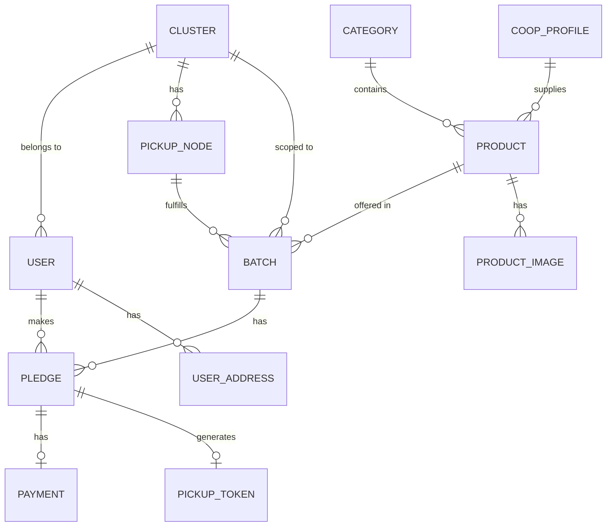

# GatherCart — Database Design (Supabase PostgreSQL)

> **Status**: Approved (Phase 0/1) — Targeting Supabase PostgreSQL.

---

## Confirmed Business Rules

| Rule | Detail |
|------|--------|
| **Database** | **Supabase PostgreSQL** (Managed cloud PostgreSQL via JDBC connection pooler or direct) |
| **Batch auto-close** | Auto-close when `current_quantity == target_quantity` — no admin step |
| **Payment window** | **5–10 minutes** from batch confirmation (configured per batch) |
| **Failed payment** | Auto-release spot. **Penalty** if user waited > 8 minutes before failing (wasted others' time) |
| **Household limit** | Enforced per **phone number** |
| **Pledge modification** | Users can increase or decrease quantity while batch is OPEN |
| **Cancel after confirmed** | Allowed — user can cancel even after batch confirms, before paying |
| **Pledges per batch** | One pledge per user per batch (modify existing, don't create second) |

---

## Entity-Relationship Diagram



---

## Table Definitions

### 1. `cluster`

Neighbourhood buying circle (e.g., Indiranagar 560038).

```sql
CREATE TABLE cluster (
    id                      BIGINT UNSIGNED NOT NULL AUTO_INCREMENT,
    name                    VARCHAR(100) NOT NULL,
    display_name            VARCHAR(200) NOT NULL,
    pincode                 VARCHAR(10) NOT NULL,
    city                    VARCHAR(100) NOT NULL,
    state                   VARCHAR(100) NOT NULL,
    participating_families  INT UNSIGNED NOT NULL DEFAULT 0,
    total_savings           DECIMAL(12, 2) NOT NULL DEFAULT 0.00,
    next_delivery_date      DATETIME NULL,
    is_active               BOOLEAN NOT NULL DEFAULT TRUE,
    created_at              DATETIME NOT NULL DEFAULT CURRENT_TIMESTAMP,
    updated_at              DATETIME NOT NULL DEFAULT CURRENT_TIMESTAMP ON UPDATE CURRENT_TIMESTAMP,

    PRIMARY KEY (id),
    INDEX idx_cluster_pincode (pincode),
    INDEX idx_cluster_active (is_active)
) ENGINE=InnoDB DEFAULT CHARSET=utf8mb4 COLLATE=utf8mb4_unicode_ci;
```

---

### 2. `pickup_node`

Physical pickup/drop-off location within a cluster.

```sql
CREATE TABLE pickup_node (
    id                  BIGINT UNSIGNED NOT NULL AUTO_INCREMENT,
    cluster_id          BIGINT UNSIGNED NOT NULL,
    name                VARCHAR(200) NOT NULL,
    address_line1       VARCHAR(300) NOT NULL,
    address_line2       VARCHAR(300),
    landmark            VARCHAR(200),
    pincode             VARCHAR(10) NOT NULL,
    latitude            DECIMAL(10, 8) NULL,
    longitude           DECIMAL(11, 8) NULL,
    operating_hours     VARCHAR(100),
    floor_info          VARCHAR(50),
    is_default          BOOLEAN NOT NULL DEFAULT FALSE,
    delivery_fee        DECIMAL(8, 2) NOT NULL DEFAULT 0.00,
    coordinator_name    VARCHAR(100),
    coordinator_phone   VARCHAR(20),
    coordinator_address VARCHAR(300),
    is_active           BOOLEAN NOT NULL DEFAULT TRUE,
    created_at          DATETIME NOT NULL DEFAULT CURRENT_TIMESTAMP,
    updated_at          DATETIME NOT NULL DEFAULT CURRENT_TIMESTAMP ON UPDATE CURRENT_TIMESTAMP,

    PRIMARY KEY (id),
    FOREIGN KEY (cluster_id) REFERENCES cluster(id) ON DELETE RESTRICT,
    INDEX idx_pickup_node_cluster (cluster_id)
) ENGINE=InnoDB DEFAULT CHARSET=utf8mb4 COLLATE=utf8mb4_unicode_ci;
```

---

### 3. `category`

Product category for filtering (Rice & Grains, Cold Pressed Oils, etc.).

```sql
CREATE TABLE category (
    id              BIGINT UNSIGNED NOT NULL AUTO_INCREMENT,
    name            VARCHAR(100) NOT NULL,
    icon            VARCHAR(50),
    display_order   INT NOT NULL DEFAULT 0,
    is_active       BOOLEAN NOT NULL DEFAULT TRUE,
    created_at      DATETIME NOT NULL DEFAULT CURRENT_TIMESTAMP,

    PRIMARY KEY (id),
    UNIQUE KEY uk_category_name (name)
) ENGINE=InnoDB DEFAULT CHARSET=utf8mb4 COLLATE=utf8mb4_unicode_ci;
```

---

### 4. `coop_profile`

Mill / Farmer cooperative that supplies products.

```sql
CREATE TABLE coop_profile (
    id              BIGINT UNSIGNED NOT NULL AUTO_INCREMENT,
    coop_id_code    VARCHAR(50) NOT NULL,
    name            VARCHAR(200) NOT NULL,
    location        VARCHAR(300),
    description     TEXT,
    is_verified     BOOLEAN NOT NULL DEFAULT FALSE,
    vpa             VARCHAR(100),
    bank_name       VARCHAR(100),
    created_at      DATETIME NOT NULL DEFAULT CURRENT_TIMESTAMP,
    updated_at      DATETIME NOT NULL DEFAULT CURRENT_TIMESTAMP ON UPDATE CURRENT_TIMESTAMP,

    PRIMARY KEY (id),
    UNIQUE KEY uk_coop_profile_code (coop_id_code)
) ENGINE=InnoDB DEFAULT CHARSET=utf8mb4 COLLATE=utf8mb4_unicode_ci;
```

---

### 5. `product`

A product available for group buying.

```sql
CREATE TABLE product (
    id                      BIGINT UNSIGNED NOT NULL AUTO_INCREMENT,
    name                    VARCHAR(200) NOT NULL,
    description             TEXT,
    detailed_description    TEXT,
    category_id             BIGINT UNSIGNED NOT NULL,
    coop_profile_id         BIGINT UNSIGNED NULL,
    unit_label              VARCHAR(50) NOT NULL,
    unit_weight_kg          DECIMAL(8, 2) NULL,
    mrp                     DECIMAL(10, 2) NOT NULL,
    group_price             DECIMAL(10, 2) NOT NULL,
    image_url               VARCHAR(500),
    is_lab_verified         BOOLEAN NOT NULL DEFAULT FALSE,
    is_pesticide_tested     BOOLEAN NOT NULL DEFAULT FALSE,
    harvest_date            VARCHAR(50),
    moisture_level          VARCHAR(50),
    grain_type              VARCHAR(50),
    processing              VARCHAR(100),
    is_active               BOOLEAN NOT NULL DEFAULT TRUE,
    created_at              DATETIME NOT NULL DEFAULT CURRENT_TIMESTAMP,
    updated_at              DATETIME NOT NULL DEFAULT CURRENT_TIMESTAMP ON UPDATE CURRENT_TIMESTAMP,

    PRIMARY KEY (id),
    FOREIGN KEY (category_id) REFERENCES category(id) ON DELETE RESTRICT,
    FOREIGN KEY (coop_profile_id) REFERENCES coop_profile(id) ON DELETE SET NULL,
    INDEX idx_product_category (category_id),
    INDEX idx_product_active (is_active),
    CONSTRAINT chk_product_prices CHECK (group_price <= mrp),
    CONSTRAINT chk_product_positive CHECK (mrp > 0 AND group_price > 0)
) ENGINE=InnoDB DEFAULT CHARSET=utf8mb4 COLLATE=utf8mb4_unicode_ci;
```

---

### 6. `product_image`

Additional product images (gallery).

```sql
CREATE TABLE product_image (
    id              BIGINT UNSIGNED NOT NULL AUTO_INCREMENT,
    product_id      BIGINT UNSIGNED NOT NULL,
    image_url       VARCHAR(500) NOT NULL,
    display_order   INT NOT NULL DEFAULT 0,
    is_verified     BOOLEAN NOT NULL DEFAULT FALSE,
    created_at      DATETIME NOT NULL DEFAULT CURRENT_TIMESTAMP,

    PRIMARY KEY (id),
    FOREIGN KEY (product_id) REFERENCES product(id) ON DELETE CASCADE,
    INDEX idx_product_image_product (product_id)
) ENGINE=InnoDB DEFAULT CHARSET=utf8mb4 COLLATE=utf8mb4_unicode_ci;
```

---

### 7. `user`

Registered platform user.

```sql
CREATE TABLE user (
    id                          BIGINT UNSIGNED NOT NULL AUTO_INCREMENT,
    full_name                   VARCHAR(150) NOT NULL,
    email                       VARCHAR(255) NOT NULL,
    phone                       VARCHAR(20) NOT NULL,
    password_hash               VARCHAR(255) NOT NULL,
    cluster_id                  BIGINT UNSIGNED NULL,
    preferred_pickup_node_id    BIGINT UNSIGNED NULL,
    handover_preference         ENUM('COMMUNITY_PICKUP', 'GUARD_DESK') NOT NULL DEFAULT 'COMMUNITY_PICKUP',
    role                        ENUM('CUSTOMER', 'ADMIN', 'COORDINATOR') NOT NULL DEFAULT 'CUSTOMER',
    is_active                   BOOLEAN NOT NULL DEFAULT TRUE,
    penalty_count               INT UNSIGNED NOT NULL DEFAULT 0,
    created_at                  DATETIME NOT NULL DEFAULT CURRENT_TIMESTAMP,
    updated_at                  DATETIME NOT NULL DEFAULT CURRENT_TIMESTAMP ON UPDATE CURRENT_TIMESTAMP,

    PRIMARY KEY (id),
    UNIQUE KEY uk_user_email (email),
    UNIQUE KEY uk_user_phone (phone),
    FOREIGN KEY (cluster_id) REFERENCES cluster(id) ON DELETE SET NULL,
    FOREIGN KEY (preferred_pickup_node_id) REFERENCES pickup_node(id) ON DELETE SET NULL,
    INDEX idx_user_cluster (cluster_id)
) ENGINE=InnoDB DEFAULT CHARSET=utf8mb4 COLLATE=utf8mb4_unicode_ci;
```

> [!NOTE]
> `penalty_count` tracks the number of times this user's payment expired after 8+ minutes. Can be used for future trust scoring.

---

### 8. `user_address`

User delivery address(es).

```sql
CREATE TABLE user_address (
    id              BIGINT UNSIGNED NOT NULL AUTO_INCREMENT,
    user_id         BIGINT UNSIGNED NOT NULL,
    address_line1   VARCHAR(300) NOT NULL,
    address_line2   VARCHAR(300) NOT NULL,
    pincode         VARCHAR(10) NOT NULL,
    is_default      BOOLEAN NOT NULL DEFAULT FALSE,
    created_at      DATETIME NOT NULL DEFAULT CURRENT_TIMESTAMP,

    PRIMARY KEY (id),
    FOREIGN KEY (user_id) REFERENCES user(id) ON DELETE CASCADE,
    INDEX idx_user_address_user (user_id)
) ENGINE=InnoDB DEFAULT CHARSET=utf8mb4 COLLATE=utf8mb4_unicode_ci;
```

---

### 9. `batch`

A group-buying batch/offer for a specific product in a cluster.

```sql
CREATE TABLE batch (
    id                  BIGINT UNSIGNED NOT NULL AUTO_INCREMENT,
    batch_code          VARCHAR(50) NOT NULL,
    product_id          BIGINT UNSIGNED NOT NULL,
    cluster_id          BIGINT UNSIGNED NOT NULL,
    pickup_node_id      BIGINT UNSIGNED NULL,
    target_quantity     INT UNSIGNED NOT NULL,
    current_quantity    INT UNSIGNED NOT NULL DEFAULT 0,
    household_limit     INT UNSIGNED NOT NULL DEFAULT 3,
    status              ENUM('OPEN', 'CONFIRMED', 'DISPATCHED', 'DELIVERED', 'EXPIRED', 'CANCELLED') NOT NULL DEFAULT 'OPEN',
    deadline            DATETIME NOT NULL,
    payment_window_mins INT UNSIGNED NOT NULL DEFAULT 10,
    payment_deadline    DATETIME NULL,
    dispatch_date       DATETIME NULL,
    delivery_date       DATETIME NULL,
    delivery_time_slot  VARCHAR(100),
    is_free_delivery    BOOLEAN NOT NULL DEFAULT TRUE,
    created_at          DATETIME NOT NULL DEFAULT CURRENT_TIMESTAMP,
    updated_at          DATETIME NOT NULL DEFAULT CURRENT_TIMESTAMP ON UPDATE CURRENT_TIMESTAMP,

    PRIMARY KEY (id),
    UNIQUE KEY uk_batch_code (batch_code),
    FOREIGN KEY (product_id) REFERENCES product(id) ON DELETE RESTRICT,
    FOREIGN KEY (cluster_id) REFERENCES cluster(id) ON DELETE RESTRICT,
    FOREIGN KEY (pickup_node_id) REFERENCES pickup_node(id) ON DELETE SET NULL,
    INDEX idx_batch_product (product_id),
    INDEX idx_batch_cluster (cluster_id),
    INDEX idx_batch_status (status),
    INDEX idx_batch_deadline (deadline),
    CONSTRAINT chk_batch_quantity CHECK (current_quantity <= target_quantity),
    CONSTRAINT chk_batch_positive CHECK (target_quantity > 0 AND household_limit > 0)
) ENGINE=InnoDB DEFAULT CHARSET=utf8mb4 COLLATE=utf8mb4_unicode_ci;
```

> [!IMPORTANT]
> `payment_window_mins` is configurable per batch (default 10 min). When the batch auto-closes (`current_quantity == target_quantity`), `payment_deadline` is set to `NOW() + payment_window_mins`. All pledges must be paid before this deadline.

**Status Transitions**:
```
OPEN → CONFIRMED    (auto: current_quantity reaches target_quantity)
OPEN → EXPIRED      (auto: deadline passes and target not met)
OPEN → CANCELLED    (admin cancellation)
CONFIRMED → DISPATCHED   (admin: items shipped from co-op)
DISPATCHED → DELIVERED    (admin: items arrive at hub)
```

---

### 10. `pledge`

A user's pledge to join a batch with a specific quantity.

```sql
CREATE TABLE pledge (
    id                  BIGINT UNSIGNED NOT NULL AUTO_INCREMENT,
    commitment_code     VARCHAR(50) NOT NULL,
    batch_id            BIGINT UNSIGNED NOT NULL,
    user_id             BIGINT UNSIGNED NOT NULL,
    phone               VARCHAR(20) NOT NULL,
    quantity            INT UNSIGNED NOT NULL,
    unit_price          DECIMAL(10, 2) NOT NULL,
    total_amount        DECIMAL(10, 2) NOT NULL,
    mrp_total           DECIMAL(10, 2) NOT NULL,
    savings             DECIMAL(10, 2) NOT NULL,
    status              ENUM('ACTIVE', 'PAYMENT_PENDING', 'PAID', 'CANCELLED', 'RELEASED', 'PENALISED') NOT NULL DEFAULT 'ACTIVE',
    pledged_at          DATETIME NOT NULL,
    payment_due_at      DATETIME NULL,
    paid_at             DATETIME NULL,
    cancelled_at        DATETIME NULL,
    released_at         DATETIME NULL,
    penalty_applied     BOOLEAN NOT NULL DEFAULT FALSE,
    penalty_reason      VARCHAR(255) NULL,
    created_at          DATETIME NOT NULL DEFAULT CURRENT_TIMESTAMP,
    updated_at          DATETIME NOT NULL DEFAULT CURRENT_TIMESTAMP ON UPDATE CURRENT_TIMESTAMP,

    PRIMARY KEY (id),
    UNIQUE KEY uk_pledge_commitment (commitment_code),
    UNIQUE KEY uk_pledge_batch_user (batch_id, user_id),
    FOREIGN KEY (batch_id) REFERENCES batch(id) ON DELETE RESTRICT,
    FOREIGN KEY (user_id) REFERENCES user(id) ON DELETE RESTRICT,
    INDEX idx_pledge_batch (batch_id),
    INDEX idx_pledge_user (user_id),
    INDEX idx_pledge_status (status),
    INDEX idx_pledge_phone (phone),
    INDEX idx_pledge_payment_due (payment_due_at),
    CONSTRAINT chk_pledge_quantity CHECK (quantity > 0),
    CONSTRAINT chk_pledge_amount CHECK (total_amount > 0)
) ENGINE=InnoDB DEFAULT CHARSET=utf8mb4 COLLATE=utf8mb4_unicode_ci;
```

> [!NOTE]
> `phone` is stored on the pledge to enforce the household limit per phone number. The UNIQUE constraint on `(batch_id, user_id)` enforces one pledge per user per batch. Additional validation in the service layer checks that no other user with the same phone has exceeded the household limit for the same batch.

**Status Transitions**:
```
ACTIVE → PAYMENT_PENDING   (auto: batch auto-closes when target met)
ACTIVE → CANCELLED         (user cancels while batch is OPEN)
ACTIVE → EXPIRED           (batch deadline passes, target not met → all pledges expire)

PAYMENT_PENDING → PAID        (user submits UTR, verified within window)
PAYMENT_PENDING → CANCELLED   (user cancels before paying — allowed)
PAYMENT_PENDING → RELEASED    (payment window expires, waited < 8 min — no penalty)
PAYMENT_PENDING → PENALISED   (payment window expires, waited ≥ 8 min — penalty applied)
```

**Payment Expiry Logic**:
```
elapsed = NOW() - batch.payment_deadline_start
remaining = batch.payment_window_mins - elapsed

IF remaining <= 0:
    IF elapsed >= 8 minutes:
        pledge.status = 'PENALISED'
        pledge.penalty_applied = TRUE
        user.penalty_count += 1
    ELSE:
        pledge.status = 'RELEASED'
    
    batch.current_quantity -= pledge.quantity
    IF batch.current_quantity < batch.target_quantity:
        batch.status = 'OPEN'  // Re-open for new pledges
```

---

### 11. `payment`

Payment record for a pledge.

```sql
CREATE TABLE payment (
    id              BIGINT UNSIGNED NOT NULL AUTO_INCREMENT,
    pledge_id       BIGINT UNSIGNED NOT NULL,
    amount          DECIMAL(10, 2) NOT NULL,
    method          ENUM('UPI', 'BANK_TRANSFER') NOT NULL DEFAULT 'UPI',
    utr_reference   VARCHAR(50) NULL,
    coop_vpa        VARCHAR(100) NULL,
    status          ENUM('PENDING', 'VERIFIED', 'FAILED', 'REFUNDED') NOT NULL DEFAULT 'PENDING',
    paid_at         DATETIME NULL,
    verified_at     DATETIME NULL,
    created_at      DATETIME NOT NULL DEFAULT CURRENT_TIMESTAMP,
    updated_at      DATETIME NOT NULL DEFAULT CURRENT_TIMESTAMP ON UPDATE CURRENT_TIMESTAMP,

    PRIMARY KEY (id),
    UNIQUE KEY uk_payment_pledge (pledge_id),
    FOREIGN KEY (pledge_id) REFERENCES pledge(id) ON DELETE RESTRICT,
    INDEX idx_payment_utr (utr_reference),
    INDEX idx_payment_status (status)
) ENGINE=InnoDB DEFAULT CHARSET=utf8mb4 COLLATE=utf8mb4_unicode_ci;
```

---

### 12. `pickup_token`

Digital pickup pass generated after payment verification.

```sql
CREATE TABLE pickup_token (
    id                      BIGINT UNSIGNED NOT NULL AUTO_INCREMENT,
    pledge_id               BIGINT UNSIGNED NOT NULL,
    pickup_node_id          BIGINT UNSIGNED NOT NULL,
    qr_code_data            VARCHAR(500) NOT NULL,
    manual_pin              VARCHAR(10) NOT NULL,
    tamper_seal_id          VARCHAR(50) NULL,
    pickup_window_start     DATETIME NOT NULL,
    pickup_window_end       DATETIME NOT NULL,
    status                  ENUM('ACTIVE', 'COLLECTED', 'EXPIRED') NOT NULL DEFAULT 'ACTIVE',
    collected_at            DATETIME NULL,
    created_at              DATETIME NOT NULL DEFAULT CURRENT_TIMESTAMP,

    PRIMARY KEY (id),
    UNIQUE KEY uk_pickup_token_pledge (pledge_id),
    FOREIGN KEY (pledge_id) REFERENCES pledge(id) ON DELETE RESTRICT,
    FOREIGN KEY (pickup_node_id) REFERENCES pickup_node(id) ON DELETE RESTRICT,
    INDEX idx_pickup_token_status (status)
) ENGINE=InnoDB DEFAULT CHARSET=utf8mb4 COLLATE=utf8mb4_unicode_ci;
```

---

## Relationship Summary

| Relationship | Type | Cascade | Description |
|-------------|------|---------|-------------|
| Cluster → Users | 1:N | SET NULL | Users belong to a cluster |
| Cluster → Pickup Nodes | 1:N | RESTRICT | Each cluster has pickup locations |
| Cluster → Batches | 1:N | RESTRICT | Batches are scoped to a cluster |
| Category → Products | 1:N | RESTRICT | Products belong to a category |
| CoopProfile → Products | 1:N | SET NULL | Co-op supplies products |
| Product → Product Images | 1:N | CASCADE | Gallery images |
| Product → Batches | 1:N | RESTRICT | A product can have multiple batches |
| Batch → Pledges | 1:N | RESTRICT | Users pledge into batches |
| User → Pledges | 1:N | RESTRICT | A user can have many pledges |
| User → User Addresses | 1:N | CASCADE | Multiple addresses |
| Pledge → Payment | 1:1 | RESTRICT | One payment per pledge |
| Pledge → Pickup Token | 1:1 | RESTRICT | One token per pledge |
| Batch → Pickup Node | N:1 | SET NULL | Batch assigned to a pickup node |

---

## Data Integrity Requirements

1. **Batch auto-close**: When a pledge is created/modified and `batch.current_quantity == batch.target_quantity`, automatically set `batch.status = 'CONFIRMED'` and `batch.payment_deadline = NOW() + payment_window_mins`.

2. **Payment window enforcement**: A scheduled task (or application-level timer) must check every ~30 seconds for pledges where `payment_due_at < NOW()` and `status = 'PAYMENT_PENDING'`. These are released (or penalised if elapsed ≥ 8 min).

3. **Household limit per phone**: Before creating/modifying a pledge, query: `SELECT SUM(quantity) FROM pledge WHERE batch_id = ? AND phone = ? AND status IN ('ACTIVE', 'PAYMENT_PENDING', 'PAID')`. The sum + requested quantity must not exceed `batch.household_limit`.

4. **Batch capacity**: `batch.current_quantity + requested_quantity <= batch.target_quantity`. Enforce via `SELECT ... FOR UPDATE` on the batch row.

5. **One pledge per user per batch**: Enforced by `UNIQUE(batch_id, user_id)`. Modification updates the existing row.

6. **Price snapshots**: `pledge.unit_price` captures the group price at pledge time.

7. **Re-open on release**: If a paid/pending pledge is released or cancelled after the batch was CONFIRMED, and `current_quantity < target_quantity`, the batch may revert to OPEN if still before deadline.

8. **Concurrent pledge protection**: Use pessimistic locking (`SELECT ... FOR UPDATE`) on the batch row when creating or modifying pledges.

---

## Indexes Strategy

| Table | Indexes | Purpose |
|-------|---------|---------|
| `cluster` | pincode, is_active | Location lookup, active filter |
| `pickup_node` | cluster_id | List nodes per cluster |
| `category` | name (UK) | Uniqueness |
| `product` | category_id, is_active | Category filter, active filter |
| `product_image` | product_id | Gallery lookup |
| `user` | email (UK), phone (UK), cluster_id | Login, uniqueness, cluster filter |
| `user_address` | user_id | User's addresses |
| `batch` | batch_code (UK), product_id, cluster_id, status, deadline | Lookups, filtering |
| `pledge` | commitment_code (UK), (batch_id, user_id) (UK), phone, status, payment_due_at | Lookups, phone limit check, expiry scan |
| `payment` | pledge_id (UK), utr_reference, status | Uniqueness, UTR lookup |
| `pickup_token` | pledge_id (UK), status | Uniqueness, active tokens |
