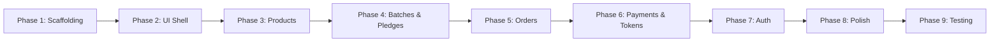

# GatherCart — Development Plan

> **Status**: Phases 1–8 Complete — Phase 9 (Integration Testing & Stabilization) pending.

---

## Project Overview

**GatherCart** (branded "NeighbourBuy" in the UI) is a neighbourhood group-buying grocery platform for India. Users in the same residential cluster collectively pledge to buy bulk quantities of staple groceries (rice, oils, ghee, dals, dry fruits) directly from farmer cooperatives at wholesale prices. Payment is collected only after the group target is met, and items are delivered to a community hub for self-pickup.

---

## Development Phases

### Phase 1: Full-Stack Project Initialization
**Goal**: Scaffold both projects, configure Supabase PostgreSQL with Spring Data JPA, establish architecture layers, and verify communication.

| Task | Details | Status |
|------|---------|--------|
| Initialize React + Vite + TypeScript project | Under `frontend/` (standardized folders: components, layouts, pages, features, hooks, services, types, utils, config) | ✅ Complete |
| Install frontend dependencies | Tailwind CSS, React Router, Axios, Lucide React | ✅ Complete |
| Initialize Spring Boot project (Maven) | Under `backend/`, Java 21, Spring Boot 3.3.x | ✅ Complete |
| Add backend dependencies | Spring Web, Spring Data JPA, PostgreSQL Driver, Lombok, Validation, Dotenv | ✅ Complete |
| Establish layered backend architecture | config, controller, service, repository, entity, dto, exception, mapper, validation | ✅ Complete |
| Configure Supabase connection | `application.yml` and `.env` with environment variables & HikariCP | ✅ Complete |
| Implement global exception handler | Consistent ApiResponse envelope with validation handling | ✅ Complete |
| Configure CORS | Allow `http://localhost:5173` | ✅ Complete |
| Create API health endpoint | `GET /api/v1/health` with Supabase live verification | ✅ Complete |
| Create Axios API client | Centralized with request/response interceptors & token prep | ✅ Complete |
| Verify frontend ↔ backend communication | Health check API call verified | ✅ Complete |
| Update project documentation | README.md, DEVELOPMENT_PLAN.md, DATABASE_DESIGN.md, API_CONTRACT.md | ✅ Complete |

**Completion Criteria**: Both applications start; Spring Boot connects to Supabase PostgreSQL; frontend communicates with backend health endpoint successfully. (Status: ✅ Complete)

---

### Phase 2: UI Foundation, Shell & Theme
**Goal**: Build the reusable component library, app shell, routing, and theme system.

| Task | Details | Status |
|------|---------|--------|
| Extract design tokens from screenshots | Colors, fonts, spacing, radii, shadows | ✅ Complete |
| Configure Tailwind theme & CSS variables | Brand palette, CSS variables in `index.css` | ✅ Complete |
| Build Header component | Logo, location selector, nav links, user menu, mobile drawer | ✅ Complete |
| Build Footer component | Trust badges, contact info, copyright | ✅ Complete |
| Build ClusterStatTicker | Families, savings, next delivery | ✅ Complete |
| Build TrustBadgesRow | 3 signature trust cards | ✅ Complete |
| Build MainLayout | Header + ticker + content + trust badges + footer | ✅ Complete |
| Configure React Router routes | All 7 screens configured and rendered | ✅ Complete |
| Build all shared components | Button, Badge, ProgressBar, CountdownTimer, PriceDisplay, QuantitySelector, Modal, Input, Breadcrumb, Card | ✅ Complete |
| Implement 3-mode theme system | Light / Dark / System Default with OS listener and localStorage persistence | ✅ Complete |
| Implement responsive design | Desktop, tablet, and mobile layouts | ✅ Complete |

**Completion Criteria**: Shell matches screenshots; navigation works; theme toggles correctly; TypeScript clean build. (Status: ✅ Complete)

---

### Phase 3: Products, Categories & Offer Browsing
**Goal**: End-to-end product/offer listing with backend data.

| Task | Details | Status |
|------|---------|--------|
| Create DB entities | `category`, `coop_profile`, `product`, `product_image` | ✅ Complete |
| Implement Product CRUD APIs | GET list (paginated), GET by ID, admin POST/PUT/DELETE | ✅ Complete |
| Implement Category API | GET all categories | ✅ Complete |
| Implement Home page | Hero section, category filter, search, sort, offer card grid | ✅ Complete |
| Implement Product Detail page | Gallery, specs, co-op profile, quality notes | ✅ Complete |
| Add seed data | Categories, co-op profiles, 6 products with images | ✅ Complete |
| Integration | Connect frontend to real APIs | ✅ Complete |
| Test | Product listing, detail, category filter, search | ✅ Complete |

**Completion Criteria**: User can browse products loaded from MySQL/PostgreSQL. (Status: ✅ Complete)

---

### Phase 4: Batches, Pledges & Group Buying
**Goal**: Core group-buying flow — batch progress, pledge creation, modification, cancellation.

| Task | Details | Status |
|------|---------|--------|
| Create DB entities | `group_purchase`, `group_participant` | ✅ Complete |
| Implement Batch APIs | GET list (with filters), GET detail, GET participants | ✅ Complete |
| Implement Pledge APIs | POST create, PATCH modify quantity, DELETE cancel | ✅ Complete |
| Implement concurrency protection | Pessimistic locking on batch row during pledge | ✅ Complete |
| Implement batch progress computation | current/target, remaining, percentage | ✅ Complete |
| Build offer cards with batch data | Status, countdown, progress bar, participant count | ✅ Complete |
| Build JoinBatchModal | Quantity selector, savings ledger, confirm/cancel | ✅ Complete |
| Build pledge actions | View/Modify, Cancel, Share to WhatsApp | ✅ Complete |
| Implement household limit enforcement | Backend validation | ✅ Complete |
| Implement batch status transitions | OPEN → CONFIRMED/EXPIRED | ✅ Complete |
| Add seed data | Batches in various states | ✅ Complete |
| Test | Create/modify/cancel pledge, concurrent pledges, capacity overflow | ✅ Complete |

**Completion Criteria**: Full group-buying workflow works through React → Spring Boot → Database. (Status: ✅ Complete)

---

### Phase 5: My Orders & Order Detail
**Goal**: User's order dashboard and order lifecycle view.

| Task | Details | Status |
|------|---------|--------|
| Implement Orders APIs | GET my orders, POST create from cart, POST cancel, GET detail | ✅ Complete |
| Build Cart & Order flow | Cart CRUD, volume tiered pricing, checkout to order | ✅ Complete |
| Build My Orders page | Summary stats, tabs, pledge & order cards, cancel modal | ✅ Complete |
| Build Order Detail page | Lifecycle view, allocated item, payment panel | ✅ Complete |
| Implement action badges | "Action Required", countdowns | ✅ Complete |
| Test | Orders, cart pricing, lifecycle and cancellation tests | ✅ Complete |

**Completion Criteria**: Users can view their pledges/orders with lifecycle status. (Status: ✅ Complete)

---

### Phase 6: Payments & Pickup Tokens
**Goal**: UPI payment submission, verification, and pickup token UI.

| Task | Details | Status |
|------|---------|--------|
| Payment panel UI | Amount display, VPA copy, UTR input, verify flow | ✅ Complete |
| Pickup Token page | QR pass, PIN, item allocation, pickup node, coordinator, inspection protocol | ✅ Complete |
| Live backend payment/token persistence | Dedicated `payment` & `pickup_token` tables/APIs | ⏳ Deferred (UI flow active; DB entities pending if needed post-MVP) |

**Completion Criteria**: Payment and pickup token user flow navigable end-to-end. (Status: ✅ MVP Complete)

---

### Phase 7: Authentication & Authorization
**Goal**: JWT-based auth with Spring Security; protect all user-owned resources.

| Task | Details | Status |
|------|---------|--------|
| Create DB entity | `app_user` (`User`) | ✅ Complete |
| Implement Auth APIs | Register, Login, Logout, `/me` | ✅ Complete |
| Configure Spring Security | JWT filter, BCrypt passwords, role-based access | ✅ Complete |
| Build Registration page | Full form matching Screen 2 | ✅ Complete |
| Build Login page | Email + password | ✅ Complete |
| Implement AuthProvider | React context, token storage, protected routes | ✅ Complete |
| Retrofit ownership | Pledges, carts, orders scoped to authenticated user via `@CurrentUser` | ✅ Complete |
| Test | Register, login, unauthorized access, cross-user isolation | ✅ Complete |

**Completion Criteria**: All resources are user-scoped; no anonymous access to protected endpoints. (Status: ✅ Complete)

> [!NOTE]
> Auth was implemented in Phase 7 after core business logic and retrofitted across all protected endpoints.

---

### Phase 8: Polish & Additional Features
**Goal**: Remaining MVP features, UI polish, edge cases.

| Task | Details | Status |
|------|---------|--------|
| Cluster seed data | Hyderabad (Madhapur) clusters & active batches seeded in `DataInitializer` | ✅ Complete |
| "How It Works" page | Process explanation page (`/how-it-works`) | ✅ Complete |
| User profile management | `PUT /api/v1/auth/profile`, `/profile` page, header avatar link & sync | ✅ Complete |
| Address management | `user_address` entity, CRUD APIs (`/api/v1/addresses`), max-5 & default selection UI | ✅ Complete |
| "Suggest New Bulk Pool" form | `bulk_pool_suggestion` entity, `POST /api/v1/pool-suggestions` + `GET /mine`, modal on Home | ✅ Complete |
| FAQ section on registration page | Static FAQ cards on `RegisterPage` | ✅ Complete |
| Share to WhatsApp deep links | Shared `wa.me` helper on OfferDetail, MyOrders, Community Desk, PickupToken | ✅ Complete |
| Upcoming cluster run preview | "Notify Me on WhatsApp" CTA on PickupToken page | ✅ Complete |
| Responsive polish & header badges | Mobile drawer profile link, dynamic active orders badge, modal/grid spacing | ✅ Complete |
| Empty states & error polish | `EmptyState` & `Alert` handling across pages | ✅ Complete |
| Post-MVP deferred items | Admin Dashboard UI, Notification Center, Account Settings, Advanced Filters | ⏳ Deferred (Post-MVP) |

**Completion Criteria**: Agreed Phase 8 MVP features implemented, integrated, and verified. (Status: ✅ Complete)

---

### Phase 9: Integration Testing & Stabilization
**Goal**: Full-stack verification, security audit, performance review.

| Task | Details |
|------|---------|
| End-to-end workflow testing | Browse → Detail → Pledge → Orders → Pay → Pickup |
| Cross-user isolation testing | Verify data ownership |
| Theme testing | Light, dark, system in all pages |
| Responsive testing | Desktop, tablet, mobile |
| Security audit | CORS, JWT, input validation, SQL injection |
| Performance review | N+1 queries, unnecessary re-renders |
| Documentation update | All .md files reflect final state |

---

## Feature Dependency Order

Each phase depends on the one before it. Phases cannot be reordered except:
- Phase 7 (Auth) could theoretically be Phase 3, but delaying it speeds up early iteration.

---

## Estimated Effort

| Phase | Effort Estimate |
|-------|----------------|
| Phase 1 | Small — scaffolding |
| Phase 2 | Medium — many components |
| Phase 3 | Medium — first E2E feature |
| Phase 4 | Large — core business logic + concurrency |
| Phase 5 | Medium — read-heavy dashboard |
| Phase 6 | Medium — payment + token generation |
| Phase 7 | Large — security across all features |
| Phase 8 | Medium — polish + extras |
| Phase 9 | Medium — testing + fixes |

---

## Confirmed Business Rules (Resolved)

All open questions have been answered. These rules govern Phase 4+ implementation:

| # | Question | Answer |
|---|----------|--------|
| 1 | **Batch auto-close** | ✅ Auto-close when `current_quantity == target_quantity` — no admin confirmation needed |
| 2 | **Payment window** | ✅ **5–10 minutes** after batch confirmation (very short — real-time urgency) |
| 3 | **Failed payment** | ✅ **Auto-release** the spot if payment fails. **Penalty** if user waited > 8 minutes before failing (wastes other participants' time) |
| 4 | **Household limit scope** | ✅ Per **phone number** (not per user account or address) |
| 5 | **Pledge modification** | ✅ Users **can increase or decrease** quantity after pledging (while batch is OPEN and capacity allows) |
| 6 | **Cancel after confirmed** | ✅ Users **can cancel** even after batch is confirmed but before paying |
| 7 | **Multiple pledges** | ✅ **One pledge per user per batch** (modify existing pledge, don't create a second)  |

> [!IMPORTANT]
> The 5–10 minute payment window is a critical UX constraint. The frontend must show a live countdown timer and the backend must enforce expiry with automatic spot release. A scheduled task or database-level TTL check is required to release unpaid pledges after the window expires.
