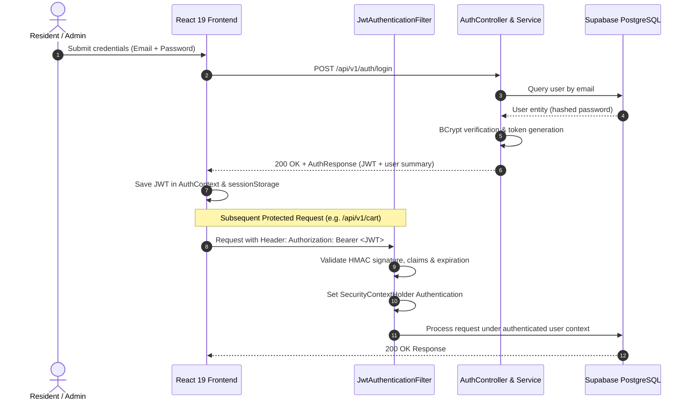

# GatherCart — Security & Authentication Architecture

> **Document Version:** 1.0 (Phase 7 Deliverable)  
> **Status:** Implemented & Verified

---

## 1. Overview & Architecture Goals

GatherCart implements a production-conscious, stateless authentication and authorization architecture designed to safeguard neighbourhood group buying while preserving smooth user experience.

### Key Tenets
1. **Stateless JWT Authentication**: Authentication is decoupled from server sessions using standard signed JSON Web Tokens (HMAC-SHA256).
2. **Robust Password Hashing**: Passwords are never stored in plaintext or reversible formats; they are salted and hashed using BCrypt (`BCryptPasswordEncoder`).
3. **Database-backed User Persistence**: User profiles and credentials are stored in PostgreSQL (`app_user` table) via Spring Data JPA.
4. **Defense in Depth**: Authorization is enforced at both the filter chain level (Spring Security `SecurityFilterChain`), method level (`@PreAuthorize`), and business service level (ownership checks).
5. **Client-side Credential Protection**: JWTs are kept in-memory in React Context for active API requests and mirrored in `sessionStorage` for page reload resilience. **Tokens and sensitive passwords are never written to `localStorage`**.
6. **Zero Password Leakage**: API response DTOs (`AuthResponse`, `UserProfileResponse`) strictly omit password hashes and cryptographic secrets.

---

## 2. Authentication Flow

---

## 3. User Management & Data Model

The `User` entity maps to the `app_user` table (avoiding SQL reserved keywords):

| Field | Type | Constraint | Description |
|---|---|---|---|
| `id` | `BIGINT` | PRIMARY KEY, AUTO_INCREMENT | Unique identifier |
| `full_name` | `VARCHAR(150)` | NOT NULL | Resident / User full name |
| `email` | `VARCHAR(255)` | NOT NULL, UNIQUE | Normalized lowercase email address |
| `phone` | `VARCHAR(20)` | NOT NULL, UNIQUE | Mobile / WhatsApp number |
| `password_hash` | `VARCHAR(255)` | NOT NULL | BCrypt hashed password |
| `role` | `VARCHAR(20)` | NOT NULL | Enum: `CUSTOMER`, `ADMIN` |
| `cluster_id` | `BIGINT` | NULLABLE | Associated neighbourhood buying cluster |
| `is_active` | `BOOLEAN` | NOT NULL (Default: true) | Account status flag |
| `penalty_count` | `INT` | NOT NULL (Default: 0) | Unpaid batch reservation penalties |
| `created_at` | `DATETIME` | NOT NULL | Timestamp of account registration |
| `updated_at` | `DATETIME` | NOT NULL | Last update timestamp |

---

## 4. Authorization Matrix

| Endpoint | Method | Required Role / Guard | Description |
|---|---|---|---|
| `/api/v1/auth/register` | `POST` | Public | Account registration |
| `/api/v1/auth/login` | `POST` | Public | Authenticate user & issue JWT |
| `/api/v1/auth/logout` | `POST` | Authenticated | Token revocation / client logout |
| `/api/v1/auth/me` | `GET` | Authenticated | Fetch current profile |
| `/api/v1/health` | `GET` | Public | System status check |
| `/api/v1/categories/**` | `GET` | Public | Category listings |
| `/api/v1/products/**` | `GET` | Public | Product browsing and details |
| `/api/v1/batches/**` | `GET` | Public | Active neighbourhood pool offers |
| `/api/v1/cart/**` | `ALL` | `CUSTOMER` or `ADMIN` | Cart operations strictly bound to authenticated `userId` |
| `/api/v1/pledges/**` | `ALL` | `CUSTOMER` or `ADMIN` | Pledge creation & modifications |
| `/api/v1/orders/**` | `ALL` | `CUSTOMER` or `ADMIN` | Order history & lifecycle detail |
| `/api/v1/admin/**` | `ALL` | `ROLE_ADMIN` | Product catalog administration & batch control |

### Service-Level Ownership Enforcement
- **Cart ownership**: `CartController` extracts authenticated user identity using `CurrentUser.require().getId()`. The client cannot pass or spoof arbitrary `X-User-Id` headers.
- **Group Purchase participation**: `GroupPurchaseService.joinGroup` requires an explicit authenticated `userId`. Pledges and cancellations can only be executed by the rightful owner.
- **Admin operations**: `AdminProductController` is annotated with `@PreAuthorize("hasRole('ADMIN')")`, preventing standard customers from modifying or deactivating inventory even if they produce a valid token.

---

## 5. Token Specification & Expiration Strategy

- **Algorithm**: HMAC-SHA256 (`HS256`) with cryptographic key derived from minimum 256-bit secret.
- **Claims Payload**:
  - `sub`: User's normalized email address
  - `userId`: Numeric identifier of the user
  - `role`: Role string (`CUSTOMER`, `ADMIN`)
  - `iat`: Epoch issue time
  - `exp`: Expiration time (Default: 24 hours / 86,400,000 ms)
- **Renewal / Expiration Handling**:
  - The client intercepts HTTP `401 Unauthorized` responses via an Axios response interceptor and dispatches a `gathercart:auth-expired` custom event.
  - The application cleanly transitions the user to the Login page with a return path saved in route state.

---

## 6. Frontend Security Architecture

1. **In-Memory Token Strategy**:
   - `AuthContext` keeps the active token in memory.
   - Axios request interceptor injects the Bearer token directly from `getAuthToken()`.
   - `sessionStorage` preserves token state across tab refreshes without making it vulnerable across disparate tabs or persistent browser sessions like `localStorage`.
2. **Protected Routes (`ProtectedRoute.tsx`)**:
   - Guards private routes (`/cart`, `/orders`, `/orders/:id`, `/orders/:id/pickup-token`).
   - Redirects unauthenticated visitors to `/login` with target route preserved in `location.state.from`.
   - Supports role-based gating (e.g. `requiredRole="ADMIN"`).
3. **Auth-Aware Navigation (`Header.tsx`)**:
   - Displays resident avatar and name with immediate single-click sign-out.
   - For unauthenticated users, provides visible access to login and registration flows.

---

## 7. Verification & Automated Test Suite

All security requirements are verified via automated tests:

- `com.gathercart.security.JwtServiceTest`:
  - Token generation & subject extraction.
  - Claims parsing & validity verification.
  - Rejection of mismatched user identities.
  - Rejection of expired tokens.
  - Rejection of malformed/tampered JWT strings.
- `com.gathercart.security.AuthControllerTest`:
  - Valid user registration (`201 Created`).
  - Duplicate email conflict rejection (`409 Conflict`).
  - Valid login credential authentication (`200 OK`).
  - Invalid password credential rejection (`401 Unauthorized`).
  - Unauthorized `/auth/me` rejection without token (`401 Unauthorized`).
  - Profile retrieval with authenticated Bearer token (`200 OK`).
  - Role-based access control blocking customer from `/admin/products` (`403 Forbidden`).
  - Unauthenticated access to `/cart` blocked (`401 Unauthorized`).
  - Public endpoints accessible without credentials (`/health`, `/products`, `/categories`).

